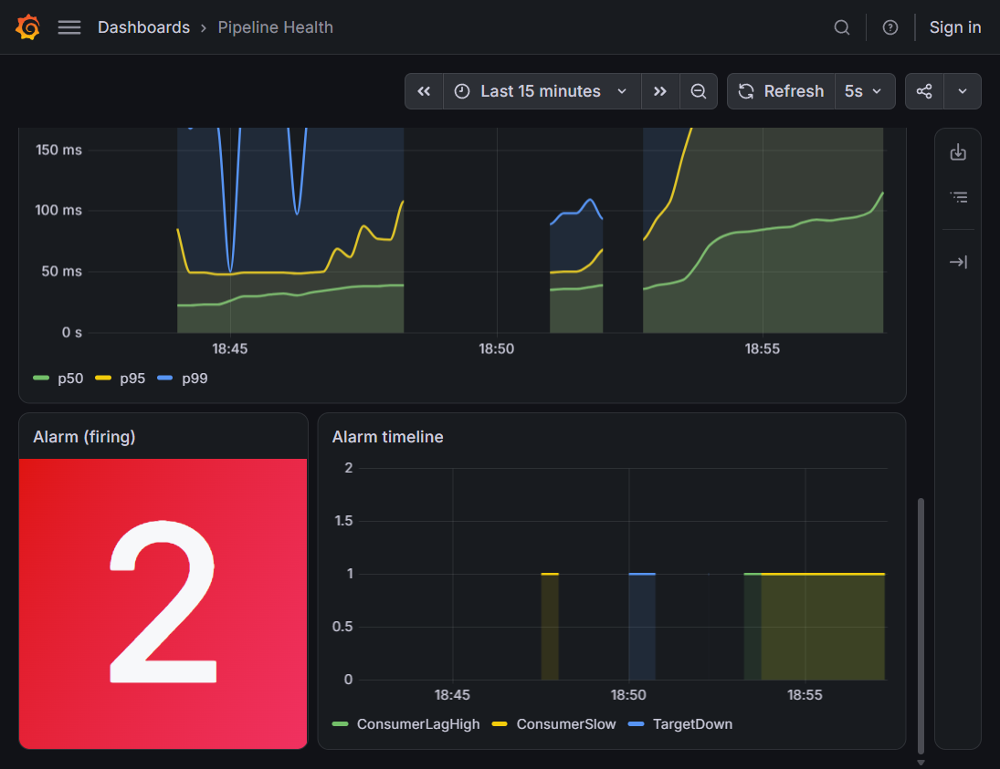
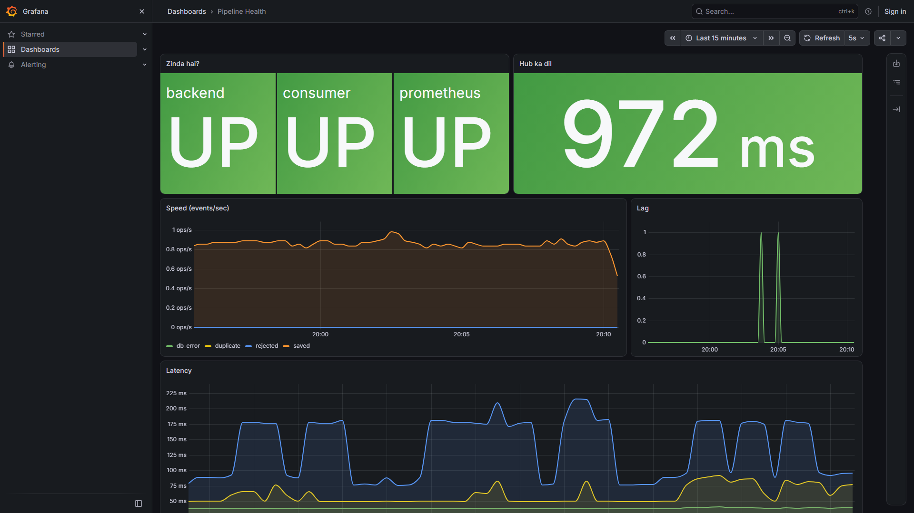

# Error Intelligence Platform

## Day 81: Event ID idempotency

Teen sawaal:

1. Ek hi event ko collector par teen baar bhejne se Postgres mein kitni rows banti hain?
2. Day 41 ka duplicate check retry ke naye Kafka message ko pakadta hai ya nahi?
3. Consumer crash aur client retry dono saath ho to ek event ki ek row rehti hai?

Audit: Day 41 ka check `(kafka_partition, kafka_offset)` unique pair par tika hai,
jo wahi Kafka message dobara padhne par kaam karta hai. `safe_producer.send_event`
event mein `event_id` nahi banata/replace karta. Ab client pehli request se pehle
UUIDv7 banata hai; har retry wahi ID bhejti hai. Collector ID ko required UUID
field ke roop mein validate karke `202` receipt mein wapas deta hai. `errors` ka
nullable unique `event_id` index purane rows/legacy events ko support karta hai.

Consumer ka `ON CONFLICT DO NOTHING` dono unique niyamon ko sambhalta hai:
Kafka redelivery par offset key conflict, aur nayi retry message par event ID
conflict. Sirf pehli insert incident/Redis/saved counters chalati hai; duplicate
sirf `consumer_events_total{result="duplicate"}` badhata hai. Isliye database
effect exactly-once hai, transport at-least-once.

`slow_response.on` collector ko event publish/accept karne ke baad 3 second rokta
hai, taaki 2-second client timeout ke baad wahi request retry ho. Switch
`.gitignore` mein hai. Test:

```text
touch slow_response.on
curl "http://localhost:8000/metrics/total-errors?service_name=dup-test"
python dup_test.py
curl "http://localhost:8000/metrics/total-errors?service_name=dup-test"
rm slow_response.on
```

Isse pehle aur baad `GET /metrics/total-errors?service_name=dup-test` count
likhein. Test code ko teen late responses ke baad `False` mil sakta hai; ID
dedup sahi ho to row-count delta phir bhi 1 aur duplicate metric kam-se-kam 2
hogi. `slow_response.on` hata kar live result yahan darj karein:

| Check | Result |
| --- | --- |
| BEFORE simulation: 3 requests with fresh IDs, DB row delta | 3 (`dup-test`: 2 -> 5); all 3 client requests timed out |
| Day 41 duplicate key | Kafka partition + offset |
| Producer event ID before this day | Nahi; producer ID nahi lagata/badalta |
| AFTER: same event ID retried 3 times, DB row delta | 1 (`dup-test`: 1 -> 2); client returned `False` after 3 timeouts |
| AFTER duplicate counter increase | 2 |
| Retry + consumer crash: 202 count X / DB row delta | X = 1,215; DB delta = 1,215, `-1` = 0, consumer lag = 0 |
| Consumer duplicate counter after crash run | 38 |
| `chain_test.py` one round | PASS; detection 30 s, recovery 91 s |

`db/001_event_id.sql` migration column/index banati hai. Backend startup bhi
existing database ke liye idempotent `ALTER TABLE`/index ensure karta hai.
Python 3.14 `uuid.uuid7()` use karta hai; older Python par `uuid6` package ka
UUIDv7 fallback use hota hai. BEFORE measurement current schema par teen
distinct IDs bhejkar old per-request-ID behavior simulate karta hai; AFTER
measurement client ke same-ID retries ka live run hai. Code deploy karne ke liye
`docker compose up --build -d backend consumer` chalao; backend migration apply
karega aur consumer nayi event ID ke saath rows save karega.

## Day 80: Collector backpressure

Teen sawaal:

1. Bheed aur dheema Kafka mein ek event ko `202` milne mein kitna time lagta hai (`p99`)?
2. Kitne requests ko `202` mila aur kitne ko `429`?
3. `429` ke baad service us event ka kya karti hai: kho jaata hai ya dobara jaata hai?

Collector ab 8 bounded in-flight slots rakhta hai:

- Khali slot hai: event Kafka publish ko bheja jaata hai aur `202` milta hai.
- 8 slots bhare hain: turant `429` aur `Retry-After: 1` milta hai.
- Client `429`/`503` par Retry-After ke hisaab se backoff aur jitter ke saath retry karta hai.
- `4xx` errors retry nahi kiye jaate; sirf retryable overload responses retry hote hain.

BEFORE/AFTER load measurements:

| Measurement | BEFORE (slow Kafka, no backpressure) | AFTER (slow Kafka, 8 slots) |
| --- | --- | --- |
| 202 / 429 count | 2707 / 1168 | 240 / 3525 |
| 202 p50/p99 | 137 ms / 323 ms | 332 ms / 4276 ms |
| 429 p50/p99 | 116 ms / 2202 ms | 130 ms / 2235 ms |
| `total-errors` delta vs 202 count | 0 / 2707 (blocked by consumer startup/backlog) | 0 / 240 (blocked by consumer startup/backlog) |
| In-flight / throttled | 0 / 4777 total | 0 / 4777 total |
| Retry mode | - | 191 202, 1 -1 |
| Chain regression | - | `chain_test` 1-round run: FAIL_DETECTION (live anomaly baseline/spike did not open an incident) |

Create the fake slow-Kafka switch in the collector working directory:

```sh
touch slow_kafka.on
python ingest_load.py 10 100
python ingest_load.py 10 20 retry
rm slow_kafka.on
```

`slow_kafka.on` must remain untracked. Capacity is `8 slots / 0.2 seconds =
40 events/sec`; slot count should stay near the thread pool size.

Grafana mein **Ingest speed** automatically `throttled` line dikhata hai aur
naya **In-flight** panel `ingest_in_flight` dikhata hai.

Gap: ye nakli Kafka delay hai. Asli Kafka band aur producer buffer hone par
collector turant bheed na dekhe aur buffer badhta jaaye.

## Day 79: Collector ingestion gate

Teen sawaal:

1. Galat event ab Kafka ya consumer tak jaane ke bajay collector ke strict Pydantic
   schema par `422` se rukta hai. Sirf valid events line mein jaati hain.
2. Darwaze ka p50/p99 live ingestion histogram se Grafana **Ingest latency**
   panel mein dekhein.
3. Kafka band ho aur existing buffer use ho to valid event `202` mil sakta hai;
   Kafka call exception kare to `503` aur `kafka_error` milta hai. Collector/
   Kafka response time live metrics se record hota hai.

Naya ingestion route:

`Payment -> POST /v1/ingest -> Kafka -> consumer -> Postgres`

Paanchon strict-schema tests Swagger se collect karke dashboard ke
`ingest_events_total{result="invalid"}` par verify karne hain.

Chain test aur runtime measurements:

| Measurement | Result |
| --- | --- |
| Ingest p50/p99 | `Run collector and inspect Grafana` |
| Kafka down: status/time | `Run the Kafka-down test and record response` |
| Rejected Events before/after | `Record before and after invalid ingestion tests` |
| chain_test vs Day 59 | `Run all three rounds and compare CSV` |
| Collector TargetDown | `Measure alert FIRING delay after Ctrl+C` |

Collector ko `uvicorn collector:app --port 8002` se chalaya jaata hai.
Grafana panels **Ingest speed** aur **Ingest latency** ka data
`/v1/ingest` aur `/metrics` se aata hai.


## Day 78: Prometheus alert rules

Teen sawaal jin ka jawab ab alarm deta hai:

1. Consumer mar jaaye to maarne se `FIRING` tak kitne second lagte hain?
2. Consumer dheema ho (`slow.on`) to kaunsa alarm bajta hai, aur kya `TargetDown`
   chup rehta hai?
3. Events jama hon to `TargetDown` aur `ConsumerLagHigh` kis order mein aate hain?

Purane tareeke mein Grafana band ho aur deewar koi na dekhe, to consumer marne
par humein pata nahi chalega jab tak hum khud dashboard na kholein. Prometheus
ab har 5 second mein niyam jaanchta hai: condition sach ho to alarm `PENDING`,
aur `for` ka waqt poora hone tak sach rahe to `FIRING`. Scrape (5 s), evaluation
(5 s) aur `for` milkar detection ka samay banate hain. Ye rules sirf Prometheus
aur Grafana mein dikhte hain; phone, email, Slack ya Alertmanager configure
nahi kiya gaya hai.

Rules [`alerts.yml`](alerts.yml) mein hain aur Prometheus ise
[`prometheus.yml`](prometheus.yml) se load karta hai. `TargetDown` har scraped
job (`prometheus`, `backend`, `consumer`) ko dekhta hai (`up == 0`),
`ConsumerSlow` consumer p99, aur `ConsumerLagHigh` queued events ko:

| Alarm | Condition | `for` | Threshold ka kaaran |
| --- | --- | --- | --- |
| `TargetDown` | `up == 0` | 15 s | Scrape/evaluation 5 s; ek chhote scrape hiccup par turant nahi bajta. |
| `ConsumerSlow` | p99 > 0.18 s | 1 min | Day 77 ke observed p99 `0.17950 s` normal aur `0.18100 s` slow ke beech; p99 estimate ko sthir rehne ka waqt diya. |
| `ConsumerLagHigh` | `consumer_lag > 200` | 15 s | Normal lag `0` tha; 200 events ka persistent backlog demo threshold hai. |

`ConsumerSlow` ka 0.18 s threshold recorded normal/slow p99 ke beech bahut
qareeb hai; workload aur histogram estimate badalne par ise apne fresh BEFORE /
DURING readings ke hisaab se tune karein. Rule health `/rules` par aur
`PENDING`/`FIRING` `/alerts` par dekhein. Grafana **Pipeline Health** dashboard
mein `Alarm (firing)` count aur `Alarm timeline` panels hain.

Q1, Q2 aur Q3 running Compose stack par live test kiye gaye. Q2 ke synthetic
events aur Q3 ke backlog events test ke liye bheje gaye; Q3 drain ke baad
teeno alerts wapas inactive hue.

| Sawaal | Jawab / measurement |
| --- | --- |
| Q1: consumer stop se TargetDown FIRING tak | Teen runs: `26.3`, `26.3`, `26.4` s (min/avg/max `26.3 / 26.3 / 26.4`); `5 + 5 + 15 = 25` s se lagbhag 1.3 s zyada. |
| Q2: slow consumer | 2 test events/s par `ConsumerSlow` pehle `25.4 s` mein PENDING hua aur p99 ke threshold ke neeche aane se `for: 1m` reset hua; `225.1 s` mein FIRING hua (p99 `0.2106 s`). `TargetDown` poore test mein inactive raha. |
| Q3: pile-up | Consumer stop ke `24.4 s` baad `TargetDown` FIRING. 6,000 queued events ke saath consumer restart ke `34.3 s` baad `TargetDown` inactive aur `ConsumerLagHigh` PENDING (lag `5,708`); `50.4 s` par FIRING (lag `5,406`). Lag 200 se neeche drain hone par `ConsumerLagHigh` inactive hua. |

Dashboard JSON: [`grafana/pipeline-health.json`](grafana/pipeline-health.json).


## Day 77: Grafana Pipeline Health dashboard

Teen sawaal jin ka jawab ek hi time-axis par dashboard se dekha ja sakta hai:

1. Pichhle 15 minute mein consumer kab-kab dheema ya band tha?
2. Consumer dheema ho jaaye (`slow.on`) to kaunse number badalte hain aur
   kaunse nahi?
3. Consumer mar jaaye to kya dikhta hai, aur kya "mara hua" aur "dheema" ek
   jaise dikhte hain?

Grafana Prometheus se `http://prometheus:9090` par judta hai. Docker Compose
network mein `localhost` Grafana container khud hota hai, isliye datasource
provisioning compose service name `prometheus` use karti hai. `grafana-data`
Grafana ka state rakhta hai; datasource, dashboard provider aur dashboard JSON
repo mein hain. Grafana UI `http://localhost:3000` par kholein.

```sh
docker compose up -d grafana
```

Pehli login `admin` / `admin` hai. Provisioned **Pipeline Health** dashboard
mein paanch panels hain: speed (result ke hisaab se events/sec), consumer lag,
latency p50/p95/p99, scrape `up` status, aur `hub_last_ok_age_seconds`.
Default time range 15 minute aur refresh 5 second hai. `up` ka alag panel
zaroori hai: scrape band hone par baaki consumer metrics `0` ke bajaye
`No data` ho sakte hain.

Dashboard ki JSON file: [`grafana/pipeline-health.json`](grafana/pipeline-health.json).
Grafana datasource aur dashboard startup provisioning:
[`grafana/provisioning/`](grafana/provisioning/).

**Live observations:**

- NORMAL: saved speed `0.8546` events/sec, lag `0`, p50 `0.03777 s`, p95
  `0.04927 s`, p99 `0.17950 s`, aur consumer `up=1`.
- DHEEMA (`slow.on`): saved speed `0.8364` events/sec, lag `0`, p50
  `0.03778 s`, p95 `0.04928 s`, p99 `0.18100 s`, aur consumer `up=1`. Is run
  mein p99 mein sirf chhota sa movement tha; p50 aur p95 stable rahe.
- MARA HUA (`docker compose stop consumer`, 2 minute): speed, lag aur latency
  queries mein koi series nahi mili; consumer `up=0`. Ye `0` ke bajaye
  `No data` behavior tha.
- WAPSI (consumer restart, 3 minute): saved speed `0.8001` events/sec,
  lag `0`, p50 `0.03810 s`, p95 `0.04988 s`, p99 `0.08899 s`, aur
  consumer `up=1`. Lag ka pahaad is run mein dashboard pe dekha gaya.

| Sawaal / live observation | Jawab |
| --- | --- |
| Pichhle 15 minute mein kab dheema ya band tha? | DHEEMA interval mein p99 uthne aur MARA HUA interval mein consumer `up=0` hua. |
| Dheema hone par kya badla? | p99 thoda utha; p50/p95, speed, lag aur `up` stable/UP rahe. |
| Marne par kya badla, aur dheema se farq? | `up=0`, speed/lag/latency par `No data`; dheema mein service UP tha aur tail latency badhi. |
| Wapsi par lag ka pahaad dikha? | Haan, consumer restart ke baad Lag panel mein value spikes aur recovery dikhai. |

Live observation screenshot: 

Teeno producers chala kar dashboard par NORMAL 3 minute dekhein; DHEEMA ke liye
`docker compose exec consumer touch slow.on` karke 3 minute dekhein. MARA HUA
se pehle switch hata kar consumer rokein, 2 minute baad wapas chalaein, phir
3 minute dekhein:

```sh
docker compose exec consumer rm slow.on
docker compose stop consumer
# 2 minute intezaar
docker compose start consumer
```

In chaaron phases ko ek 15-minute view mein capture karein. Consumer ko
alag se band karne par stack ko test ke baad dobara chalana na bhoolein.

## Day 76: Consumer latency histogram

Teen sawaal jo Day 75 ke Counter aur Gauge se nahi milte the:

1. Consumer ek event ko aam taur par (p50) kitne ms mein nipta raha hai?
2. Sabse dheere 1% events (p99) kitne ms lete hain?
3. Jab 50 mein se 1 event dheema ho jaaye, to pehle average hilta hai ya p99?

`consumer_event_seconds` har event ki processing time naapta hai; Kafka se
message ka intezaar aur batch offset commit is timing ke bahar hain. Iske
`_bucket` series cumulative hain (`le` = less than or equal), aur `_count` /
`_sum` event count aur kul processing seconds dete hain.

Raw bucket padhna: 10 ms tak hue events ki tadaad `le="0.01"` bucket hai.
Average `_sum / _count` hai. Haath se p99 ke liye `_count * 0.99` nikaalo,
phir pehla aisa `le` bucket chuno jiska cumulative count us rank tak pahunchta
ho. Ye bucket-based andaaza hai; `+Inf` se aage exact latency nahi milti.

Example (sample numbers, live measurement nahi): 480 events `le="0.01"` tak,
497 `le="0.025"` tak, `_count=500`, `_sum=3.1` seconds. Average
`3.1 / 500 = 0.0062` seconds (6.2 ms); p99 rank `500 * 0.99 = 495`,
isliye haath ka p99 dibba `le="0.025"` (10-25 ms) hai. Prometheus p99 isi
histogram se niklega aur bucket estimate ke aaspaas hona chahiye.

Prometheus Graph mein:

```promql
histogram_quantile(0.50, sum by (le) (rate(consumer_event_seconds_bucket[1m])))
histogram_quantile(0.95, sum by (le) (rate(consumer_event_seconds_bucket[1m])))
histogram_quantile(0.99, sum by (le) (rate(consumer_event_seconds_bucket[1m])))
rate(consumer_event_seconds_sum[1m]) / rate(consumer_event_seconds_count[1m])
increase(consumer_event_seconds_count[5m])
sum(increase(consumer_events_total[5m]))
```

`p99_processing_latency` is represented by the p99 PromQL query above; the
exported source metric remains the `consumer_event_seconds` histogram. Expect
p50 <= p95 <= p99. The histogram count and summed result Counter should be
approximately equal when no event fails before completion. A `NaN` quantile
means the selected rate window had no observations.
Expected slow-switch behavior: 2% of events are deliberately delayed, so p99
should rise toward the `0.1`-to-`0.25` second bucket while p50 and usually p95
stay near their normal range; the average rises, but typically much less than
p99. This answers question 3: **p99 moves first and much more noticeably than
the average**. Replace the `Not measured` cells below with the three live
BEFORE/DURING/AFTER readings.

| Measurement | p50 | p95 | p99 | Average |
| --- | ---: | ---: | ---: | ---: |
| BEFORE (`slow.on` absent) | Not measured | Not measured | Not measured | Not measured |
| DURING (`slow.on` present) | Not measured | Not measured | Not measured | Not measured |
| AFTER (`slow.on` removed) | Not measured | Not measured | Not measured | Not measured |

Hand-count and Prometheus comparison (fill in from `/metrics` and PromQL):

| Check | Result |
| --- | --- |
| Events at or below 10 ms | Not measured |
| Hand-calculated average | Not measured |
| Hand-calculated p99 bucket | Not measured |
| Prometheus p99 | Not measured |
| Histogram `_count` vs result Counter total | Not measured |

Run the three simulator processes, record the four values after each three
minute interval, and compare the raw p99 bucket with the Prometheus p99. The
optional `slow.on` switch makes 2% of events sleep for 200 ms; in Docker it
must be created inside the consumer container:

```sh
docker compose exec consumer touch slow.on
docker compose exec consumer rm slow.on
```

For a locally run consumer, create/remove `slow.on` in its working directory.
Average can move only a little while p99 rises sharply because the slowest
events affect the tail directly.

## Day 75: Consumer metrics

The consumer exports labelled Prometheus metrics on port `8001`:

```text
consumer_events_total{result="saved"}
consumer_events_total{result="duplicate"}
consumer_events_total{result="rejected"}
consumer_events_total{result="db_error"}
consumer_lag
consumer_event_seconds_bucket{le="0.01"}
consumer_event_seconds_count
consumer_event_seconds_sum
```

Useful PromQL:

```promql
rate(consumer_events_total{result="saved"}[1m])
consumer_lag
increase(consumer_events_total{result="duplicate"}[10m])
increase(consumer_events_total{result="rejected"}[10m])
increase(consumer_events_total{result="db_error"}[10m])
up{job="consumer"}
```

Day 75 measurements (run against the live stack):

| Question | Result |
| --- | --- |
| Consumer saved events per second | 0.545/s during sustained test |
| Kafka events waiting in the consumer lag | 0 |
| Duplicate events in the last 10 minutes | 3 |

## Day 74: Prometheus monitoring

Prometheus pulls `/metrics` every five seconds. The backend exports the current
`ws_clients` and `hub_last_ok_age_seconds` gauges, plus `hub_cycles_total`
counters labeled by `result="ok"` or `result="fail"`. Prometheus is available
at `http://localhost:9090`; check `/targets` to confirm both scrape jobs are UP.

Useful PromQL:

```promql
increase(hub_cycles_total{result="ok"}[1m])
increase(hub_cycles_total{result="fail"}[10m])
hub_last_ok_age_seconds
ws_clients
up{job="backend"}
```

Day 74 measurements (run against the live stack):

| Check | Result |
| --- | --- |
| Successful hub cycles in one minute | 60.02 |
| Failed cycles during 30 seconds with Postgres stopped | 4 (Prometheus `increase` was 4.02) |
| Hub failure log lines during that test | 1 |
| Hub recovery after Postgres became ready | 0.82 s |
| `ws_clients` with three dashboard tabs (then one) | 3 (then 1) |
| Backend scrape `up=0` detection time | 7.67 s |

During the Postgres outage the hub completed four failed cycles, not thirty:
the stopped database caused hostname-resolution errors that delayed each
snapshot attempt. The age gauge reached about 31 seconds, and the hub recovered
without a backend restart once Postgres was ready.

## Real-time: polling vs WebSocket

- Polling baseline (Fetch/XHR over 60 seconds): not measured yet; record as `Polling: X requests/min per tab`.
- `WS /ws/live` is one persistent connection and pushes the full `/stats` snapshot once each second. `total_errors` remains in its existing position for older dashboard clients.
- `total_errors` comes from Redis when available and falls back to Postgres. If the snapshot cannot be read, the hub logs the failed cycle and retries on its next tick instead of sending a fake snapshot.
- The dashboard's stats cards use this WebSocket; charts and tables continue polling REST endpoints every five seconds.
- If the WebSocket is disconnected or has no usable stats yet, the cards fall back to the polled `/stats` value. An open connection with no message for more than three seconds is marked `STALE · Ns`, and the stats cards are dimmed; a disconnected connection is marked `Reconnecting…`.
- `GET /health` includes `ws_clients`, the number of currently connected WebSocket clients, and `hub_last_ok_age_s`, the seconds since the last successful hub cycle.
- The hub retries failed cycles without restarting, logs the first failure and every tenth consecutive failure, and logs when it recovers. No polling fallback is added for a connected-but-stale WebSocket; charts and tables continue their existing polling behavior.
- `python ws_load.py 1` and `python ws_load.py 20` measure Redis commands/sec and aggregate WebSocket messages/sec. Record the results here:

  | Clients | Redis commands/sec (before) | Redis commands/sec (after) |
  | --- | ---: | ---: |
  | 1 | Not measured in this session | Not measured in this session |
  | 20 | Not measured in this session | Not measured in this session |

- Server har second total ek baar padhta hai aur sab dashboards ko broadcast karta hai, isliye tabs badhne par Redis ka load nahi badhta.
- `WS /ws/live` now broadcasts the same full stats snapshot returned by `GET /stats`; the existing `total_errors` key is preserved. REST and WebSocket both use `build_stats`.
- `/stats` timing (`python stats_timing.py`, 30 requests): average 25 ms, p95 47 ms, max 56 ms. Since p95 is under 200 ms, the hub uses `every_sec=1`.
- WebSocket message ka shape `/stats` jaisa hi hai: ek shape, do raaste.

Real WebSocket snapshot:

```json
{
  "total_errors": 57317,
  "total_source": "redis",
  "errors_per_minute": 0,
  "active_incidents": 0,
  "system_health": "HEALTHY"
}
```

## Root cause heuristic (cross-service correlation)

`GET /incident-correlation` checks open anomaly incidents. If multiple
incidents started within five minutes, it reports the earliest one as the
probable root cause and the later incidents as affected, with their lag in
seconds. This is a heuristic, not AI: an earlier incident is not necessarily
the cause. Since the watcher checks every 10 seconds, `lag_seconds` can vary
by roughly 10-15 seconds.

Live switch test (Payment ON, then Order ON 20 seconds later):

```json
{
  "root_cause": {
    "service_name": "order-service",
    "started_at": "2026-11-05T09:14:06.969508",
    "top_error": "DatabaseConnectionError (86 errors, last 5 min)"
  },
  "affected": [
    {
      "service_name": "payment-service",
      "lag_seconds": 0,
      "top_error": "PaymentGatewayTimeout (124 errors, last 5 min)"
    }
  ]
}
```

In this run, the watcher opened both incidents in the same observation, so
their incident start times tied and the response could not recover the
20-second switch order. The endpoint reports observed incident order, not
causality or the time a failure switch was flipped.

## Day 54: Pipeline load test

The load test sends events through `POST /errors` and waits for them to be
persisted by the Kafka consumer in PostgreSQL. Events use the `load-test`
service name, so they can be separated from normal simulator traffic.
`GET /metrics/total-errors` returns `{"total": ...}` with the current number
of rows in the errors table; its optional `service_name` filter lets the load
test count only its own events even if other producers are active.

Start PostgreSQL, Kafka, the consumer, and the API. Stop the service simulators
and anomaly watcher during a run so unrelated events do not affect the total
count. In another terminal, run:

```text
python load_test.py 100
python load_test.py 1000
python load_test.py 5000
python load_test.py 10000
```

Successful runs are recorded in `load_test_results.csv`. The 100-event smoke
run is intentionally excluded from the baseline because it encountered an
existing Kafka backlog. Results from the real runs:

| Label | Events | Sender events/sec | Pipeline events/sec | Result |
|---|---:|---:|---:|---|
| baseline | 1,000 | 75.7 | 24.4 | completed |
| baseline | 5,000 | N/A | N/A | timed out after 300 seconds |
| baseline | 10,000 | N/A | N/A | timed out after 300 seconds |

The completed run shows the consumer is the bottleneck: the pipeline ran at
24.4 events/sec versus 75.7 events/sec sent, with 27.9 seconds of additional
drain time. The 5,000- and 10,000-event runs did not fully drain before the
timeout, so they have no completed pipeline-throughput value.

After recording the baseline, remove only the test service's data from
PostgreSQL:

```sql
DELETE FROM errors WHERE service_name = 'load-test';
DELETE FROM incidents WHERE service_name = 'load-test';
DELETE FROM anomaly_events WHERE service_name = 'load-test';
```

## Day 55: Batch Kafka offset commits

The consumer now commits offsets after every 100 successfully handled messages
or when the 5-second interval is reached while processing messages. Both saved
events and persisted rejected events count toward the batch. PostgreSQL is still
committed before the Kafka offset, and the Day 41 Kafka partition/offset
uniqueness check makes redelivered events safe after a crash.

Use drain mode to queue the events before starting the consumer. Keep the
backend, PostgreSQL, and Kafka running; stop the consumer, simulators, and
anomaly watcher. For the per-event baseline use the pre-Day-55 consumer, or set
`BatchCommitter(consumer, every=1)` to emulate its commit frequency. Then start
the consumer when prompted. Set `LABEL` and the committer batch size for each
run:

```text
python load_test.py 10000 drain
```

Run once each with labels `commit-1`, `commit-100` (batch size 100), and
`commit-500` (batch size 500). For every run, wait for the output and check that
`extra/duplicate` is 0. The drain results are appended to
`load_test_results.csv`. Repeat the run with the label `chaos`, stopping and
restarting the consumer twice while it drains; all events should eventually
reach PostgreSQL and the extra count should remain 0.

| Label | Consumer events/sec |
|---|---:|
| commit-1 | Not measured |
| commit-100 | Not measured |
| commit-500 | Not measured |

These Day 55 measurements and the chaos run have not yet been run against the
live services. Batch commits reduce offset-commit requests, but a crash can
redeliver up to the uncommitted batch; the database uniqueness check prevents
those redeliveries from becoming duplicate error rows.

## Day 56: Index the error timestamp

The `errors.occurred_at` index supports time-based queries against the real
errors table. It is declared in the SQLAlchemy model and ensured at backend
startup for existing databases. Creating an index adds work to writes, so
compare the consumer drain rate before and after the index with the same
10,000-event test.

To benchmark query speed independently of application data, run
[`perf/index_experiment.sql`](./perf/index_experiment.sql) against PostgreSQL.
It recreates only the synthetic `errors_big` table, with 500,000 rows spread
over the last seven days, and runs the same 15-minute aggregate query before
and after adding the timestamp index. Run each `EXPLAIN ANALYZE` query two or
three times and record the smallest `Execution Time`; note the scan plan too.
The planner may show `Bitmap Index Scan` rather than `Index Scan` when that is
the cheaper choice.

Before measuring the consumer, check which indexes already exist:

```sql
SELECT indexname, indexdef
FROM pg_indexes
WHERE tablename = 'errors';
```

At the time of this run, `errors` had `errors_pkey`, `ix_errors_fingerprint`,
`ix_errors_id`, and `uq_kafka_partition_offset`; it did not yet have an index
on `occurred_at`.

If `ix_errors_occurred_at` is absent, capture the before-index drain rate
before applying the SQL below or restarting the backend with this change
(startup automatically ensures the index). Run `python load_test.py 10000 drain`
with the consumer stopped while the events are queued. Start the consumer when
prompted and record its events/sec. Then add the index:

```sql
CREATE INDEX IF NOT EXISTS ix_errors_occurred_at ON errors (occurred_at);
```

Repeat the same drain test with the same services and settings. If the index
already existed before the first run, there is no valid before/after comparison
to report. Check that `extra/duplicate` stays at 0. Once the synthetic query
results are recorded, remove only its benchmark table:

```sql
DROP TABLE errors_big;
```

| Test | Before index | After index |
|---|---|---|
| Query: errors from the last 15 minutes (500,000 synthetic rows) | 40.466 ms (Parallel Seq Scan) | 1.143 ms (Bitmap Index Scan; about 35.4x faster) |
| Consumer drain, 10,000 events | Not measured: 36,758 older Kafka events were already queued | Not measured yet |

The 500,000 rows are synthetic and used only to benchmark query speed. The
query timings are measured by PostgreSQL. The drain comparison could not be
isolated because the Kafka consumer group already had 36,758 older events
queued before the test. The test events were queued and the consumer was
restarted to resume processing; do not treat the resulting backlog drain as a
10,000-event benchmark.

## Day 57: Anomaly incidents

An `ANOMALY` event opens an incident for that service unless one is already
open; repeated anomaly events do not create duplicates. A `NORMAL` event
resolves the open incident and records `resolved_at`, while `WARNING` leaves
incident state unchanged. `GET /anomaly-incidents` lists the latest 50
incidents and accepts an optional `?status=OPEN` filter. Live stopwatch
measurements (spike-to-open and switch-off-to-resolved) have not been taken.

## Day 59: Chain fire drill

`chain_test.py` automates the spike-to-incident-to-resolved timing test. It
defaults to the `payment-service` simulator and its file-existence switch,
`fail_payment-service.flag`; switch files are created beside the script, where
`service_simulator.py` looks for them. Change `TARGET_SERVICE` in the script
before testing another service. The API defaults to `http://127.0.0.1:8000`;
set `API_URL` to use another backend address.

Start PostgreSQL, Kafka, the backend, consumer, service simulators, and anomaly
watcher. Let the services build their baseline before the test, and resolve or
clear any old open anomaly incident for the target service. Then run:

```text
python chain_test.py
```

Each round turns the switch on until the target incident opens, holds the
failure for 30 seconds, turns it off, and waits for that incident to resolve.
The defaults are three rounds, a 60-second cooldown, and a 180-second timeout
per wait. Change the constants at the top of the script for a dry run or a
different test duration. The switch is turned off when the script exits.

Results are appended to `chain_test_results.csv` beside the script, including a
status for passed, failed, skipped, and API-error rounds. Detection and
recovery values are in whole seconds; summary output reports average, minimum,
and maximum. Live timings have not been measured yet:

| Round | Detection (spike ON to incident OPEN) | Recovery (spike OFF to RESOLVED) |
|---|---:|---:|
| 1 | Not measured | Not measured |
| 2 | Not measured | Not measured |
| 3 | Not measured | Not measured |
| Average | Not measured | Not measured |

## Day 60: Robust baseline (median and MAD)

The baseline now uses the median and median absolute deviation (MAD), with a
minimum sigma to avoid division by zero. This reduces baseline poisoning when
spike minutes are included in the lookback window. The existing `mean` and
`std_dev` response fields are retained for compatibility; their values now
represent the median and robust sigma. Both `/metrics/baseline` and anomaly
scoring use the same helper in `robust_stats.py`.

Run `python poison_lab.py` to compare the mean/std-dev and median/MAD baselines
using repeated spikes. This verifies the robust-statistics example without
requiring the live services.

Live run on 2026-11-03: the target had a robust baseline of `0.00` and sigma
`1.00` before the chain test and the same values afterward. Historical
pre-change baseline readings and Day 59 chain timings were not recorded:

| Baseline (target service) | mean / median | std_dev / sigma |
|---|---:|---:|
| Before spike (old baseline) | Not measured | Not measured |
| After one spike (old baseline) | Not measured | Not measured |
| Before and after spike (robust baseline) | 0.00 | 1.00 |

| Chain test (3 rounds) | Detection | Recovery |
|---|---:|---:|
| Day 59 (old baseline) | Not measured | Not measured |
| Day 60 (robust baseline) | Round 1: 42 s; rounds 2-3 skipped | Round 1: >180 s; rounds 2-3 skipped |

The Day 60 chain test did not pass: the first round opened an incident but did
not resolve within the 180-second timeout, so the remaining rounds were
skipped because the incident stayed open. A first attempt made before Redis
was started failed detection in all three rounds; those failures are not
included in the Day 60 timing above.

## Day 61: Top error on anomaly incidents

When an anomaly opens an incident, the backend finds the most frequent
`error_type` among that service's errors in the five-minute window ending at
the service's newest `occurred_at` value. The resulting text is stored in
`anomaly_incidents.top_error` and returned by `GET /anomaly-incidents`; it
remains on the incident after resolution. The dashboard shows it in the
“Kya toota” column. Incidents created before this change display `-`.

The backend startup adds the nullable column to existing PostgreSQL databases
with `ALTER TABLE ... ADD COLUMN IF NOT EXISTS`; `create_all` alone does not
alter an existing table. To check the aggregate manually, substitute a service
name that exists in `errors`:

```sql
SELECT error_type, COUNT(*) AS n
FROM errors
WHERE service_name = 'payment'
  AND occurred_at >= (
        SELECT MAX(occurred_at) FROM errors WHERE service_name = 'payment'
      ) - INTERVAL '5 minutes'
GROUP BY error_type
ORDER BY n DESC
LIMIT 1;
```

### Demo flow

1. Start PostgreSQL, Kafka, Redis, the backend, consumer, the service
   simulators, anomaly watcher, and frontend.
2. Let the services collect baseline data, then run `python chain_test.py` with
   `ROUNDS = 1`.
3. Confirm the incident changes from OPEN to RESOLVED after the spike is
   switched off.
4. Anomaly incident OPEN hota hai; ticket mein service, status aur sabse
   zyada aane wala error (top error) likha hota hai.
5. Agar dusri service bhi toote to Root Cause card batata hai ki pehle kaun
   toota (andaaza, pakka nahi).

The live API check on `payment-service` returned
`PaymentGatewayTimeout (136 errors, last 5 min)` and retained it after
resolution. The one-round real spike test did not detect an incident within
its 180-second timeout; the direct anomaly-event check verified the ticket
field and its persistence across resolution. The dashboard capture is
[`docs/anomaly-incident-open.png`](./docs/anomaly-incident-open.png).

## Day 64: Redis client and read baseline

`GET /stats` still reads its counts from PostgreSQL; Redis is not yet a cache
for dashboard statistics. The `read_test.py` script measures 100 sequential
requests so this is a pre-cache baseline:

| Error rows | Requests | Average | Slowest |
|---:|---:|---:|---:|
| 50,377 | 100 | 31.6 ms | 82.6 ms |

The initial row count was below 50,000, so `python load_test.py 7500` was run.
That script timed out at its 300-second limit while the consumer was draining
Kafka; the database had reached 50,377 rows by the time the read benchmark ran.
The benchmark row count was unchanged before and after the 100 requests.

Redis (`redis:7-alpine`) and the `redis` Python dependency were already
declared in Docker Compose and `requirements.txt`. The shared
`redis_client.py` reads `REDIS_HOST`/`REDIS_PORT` and has one-second connect
and socket timeouts with retries disabled. The backend reports Redis
availability without making it a dependency for backend health:

```json
{"status":"ok","redis":"ok","timestamp":"..."}
{"status":"ok","redis":"down","timestamp":"..."}
```

Both responses were checked against the live backend; stopping Redis did not
stop the backend, and the failed health check was printed in the backend log.
The Redis command exercise returned `namaste`, counter values `1` and `2`,
and `EXISTS errors:payment` returned `0` after the 60-second expiration.
Running `redis_playground.py` twice returned counter values `1` and `2`.

## Day 65: Redis per-service, per-minute error counters

After a new error is committed to PostgreSQL, the consumer increments a Redis
key for that service and the event's `occurred_at` minute, such as
`errors:payment:2026-11-08T23:10`. New keys expire after two hours. Duplicate
Kafka deliveries and rejected or failed database writes do not increment the
counter. Redis has one-second connect and command timeouts; if a Redis counter
operation fails, the consumer skips Redis attempts for ten seconds and keeps
processing events. PostgreSQL remains the source of truth, and dashboard
statistics continue to read from PostgreSQL.

Check a counter:

```text
python -c "from redis_counters import count_error; count_error('payment', '2026-11-08T23:10:05')"
docker compose exec redis redis-cli GET errors:payment:2026-11-08T23:10
```

Run `python redis_check.py` to sum all current `errors:*` keys by service and
in total.

For an isolated consistency check, first stop producers and let the consumer
drain older events. Stop the consumer, clear Redis with
`docker compose exec redis redis-cli FLUSHDB`, and record
`GET /metrics/total-errors` as N0. Start the consumer and producers, then stop
them and let the consumer drain before recording N1. The Redis total should
match N1 - N0, except for events saved to PostgreSQL immediately before a
consumer interruption. Check a sample key's `TTL`; it should be near 7200
seconds.

To check failure handling, keep the consumer and producers running, stop Redis
for 30 seconds, and verify PostgreSQL totals continue to rise while the
consumer logs at most one `Redis counter failed` line per ten seconds. Start
Redis again and confirm that new counters resume; counters missed during the
outage are not backfilled.

Benchmark with `python load_test.py 10000 drain`, using the same event count,
consumer settings, and service conditions for three runs before and three runs
after enabling the counters. Record each run's consumer events/sec and compare
the averages. The drain benchmark and outage/consistency checks have not yet
been run against live services:

| Measurement | Before Redis counters | After Redis counters |
|---|---:|---:|
| Three-run average consumer events/sec | Not measured | Not measured |
| Change | — | Not measured |

## Day 66: Redis total for `/stats` with PostgreSQL fallback

`GET /stats` reads `total_errors` from Redis only after
`total_errors_ready` confirms the total was seeded. If Redis is unavailable,
either key is missing, or the total is invalid, `/stats` falls back to the
PostgreSQL row count. `GET /metrics/total-errors` remains PostgreSQL-backed as
the comparison/source-of-truth endpoint.

The consumer increments the non-expiring `total_errors` key after each newly
inserted PostgreSQL error. Before enabling the Redis read, stop the consumer
and run `python seed_total.py` once to seed the existing table count and then
mark the total ready. Stop the consumer before reseeding after a Redis data
loss or outage; otherwise rows can be missed or counted twice.

To compare `/stats` latency with the same table size, stop services and record
the current row count and three `python read_test.py` averages before enabling
the new read. Repeat after restarting the backend, then record the measured
values here; these live service measurements have not been run as part of this
change:

| Measurement | Before Redis total (today) | After Redis total (today) |
|---|---:|---:|
| Error rows | Not measured | Not measured |
| Three-run `read_test.py` average | Not measured | Not measured |
| Average reduction | — | Not measured |

For consistency, let the services run for two minutes, stop them, and let the
consumer drain for 30 seconds. Compare `/stats` with
`/metrics/total-errors`. To test the fallback, stop Redis and open `/stats`;
the API should keep returning the PostgreSQL total and log
`Redis read failed, Postgres se gin-ti karenge`. After restoring Redis, stop the
consumer and run `python seed_total.py` to repair the total.

To verify missing-data fallback without stopping Redis:

```text
docker compose exec redis redis-cli FLUSHDB
```

With the readiness marker gone, `/stats` should use PostgreSQL. Run
`python seed_total.py` with the consumer stopped to restore the Redis fast path.

## Day 67: Compare Redis and PostgreSQL under load

`GET /stats` defaults to the Redis total and reports its path in `total_source`.
Use `GET /stats?source=postgres` to count the total directly in PostgreSQL
without reading Redis. If Redis is missing or unavailable on the default route,
the endpoint continues to fall back to PostgreSQL and reports that source.

Run `python read_test.py redis` or `python read_test.py postgres` for 200
sequential requests on one HTTP session, with a 20 ms pause between requests.
The report includes the actual source for each response, average latency, p95,
and slowest response. Stop the dashboard tab, other polling services, and
`anomaly_watcher.py` before measuring.

For the busy comparison, stop the consumer and use the Day 55/65 drain throughput
to estimate a backlog lasting at least three minutes:
`events = measured events/sec * 180`. Start the drain with
`python load_test.py <events> drain`; when it prompts, start the consumer.
Then run `redis`, `postgres`, `redis`, `postgres`, `redis`, `postgres` in that
order. All six measurements must finish before the drain ends; otherwise repeat
with a larger backlog. Record the measured events/sec, event count, and
PostgreSQL error-table row count alongside the results.

Quiet baseline: one 200-request run per source. Busy results: three alternating
200-request runs per source; average and p95 columns are means of the three
run-level values, while slowest is the maximum across the three runs. All Redis
runs reported `redis` for 200/200 responses, and all PostgreSQL runs reported
`postgres` for 200/200 responses. The initial benchmark monitor timed out after
queuing the events, but the consumer was restarted and all 5,940 test events
were confirmed in PostgreSQL. At the final snapshot the overall Kafka consumer
group still showed 47 messages of lag.

| Haalat | Source | average | p95 | slowest |
|---|---|---:|---:|---:|
| Bina bheed | postgres | 21.9 ms | 24.5 ms | 36.4 ms |
| Bina bheed | redis | 15.9 ms | 18.1 ms | 43.7 ms |
| Bheed mein (drain) | postgres | 18.6 ms | 20.6 ms | 51.0 ms |
| Bheed mein (drain) | redis | 12.6 ms | 14.4 ms | 35.2 ms |

| Drain detail | Value |
|---|---|
| Pilot consumer throughput used for sizing | 33 events/sec |
| Queued test events | 5,940 |
| PostgreSQL error-table rows after drain | 57,317 (53,174 `load-test`) |
